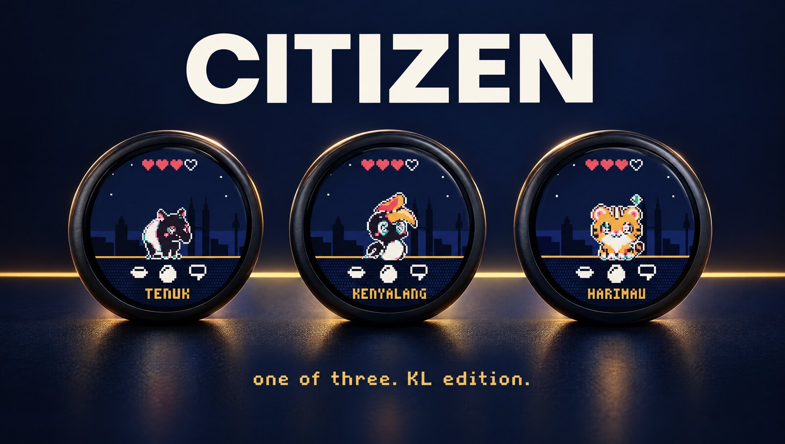

# Citizen

A pixel-art pet that lives on a round badge. Made for the speakers of [PROMPT:KL](https://connect.prmpt.city) (31 October 2026, Kuala Lumpur): each badge hatches a citizen of the city (a tapir, a hornbill or a tiger), shows it against the KL skyline, and talks to a web server that hands out new creatures, skies and event stamps.

<p align="center"></p>

This repository is everything that runs on or around the badge: the C core, the ESP32-C3 firmware, a browser simulator with a 3D view, a TypeScript SDK for the web API, the hardware docs and the art.

## What's inside

| Folder | What it is |
|---|---|
| [`core/`](core/README.md) | The badge itself, in C99 with no dependencies: state machine, gestures, Settings, every screen, sprites, a 240x240 framebuffer. The same code runs on the board and, compiled to WebAssembly, in the simulator. |
| [`firmware/`](firmware/README.md) | ESP32-C3 firmware (PlatformIO, Arduino, LovyanGFX): display, touch, deep sleep, up to 5 saved WiFi networks, a captive setup portal with a join QR, Improv WiFi over USB, sync with the server, over-the-air updates. |
| [`sim/`](sim/README.md) | The badge in the browser: the real core in WebAssembly, a hardware model (battery, WiFi, sleep), time controls, and a 3D view of the badge. |
| [`sdk/`](sdk/README.md) | A dependency-free TypeScript client for the web API. |
| [`API.md`](API.md) | The web API the badge and the SDK talk to, so you can run your own server. |
| [`docs/`](docs/) | [Hardware](docs/HARDWARE.md), the [screen gallery](docs/screens/), the [simulator docs](docs/sim/) and a [3D anatomy figure](docs/anatomy/) of the badge in its case. |
| [`assets/`](assets/README.md) | Sprites, palette, screen exports and renders. |
| [`kit/`](kit/README.md) | The speaker kit: a printed booklet on how to use the badge. |
| `tests/`, `scripts/` | Core tests, a soak test, benchmarks, `check.sh` (everything CI runs) and `provision.sh` (flash and link a badge over USB). |

## Try it

```sh
make test          # core tests; writes every screen to tests/out/
make wasm          # builds sim/core.wasm
python3 -m http.server 8787 -d sim   # then open http://localhost:8787
scripts/check.sh   # what CI runs: tests, soak, bench, wasm, the ESP32-C3 build and size budget, the simulator selftest
```

`make` needs clang; `make wasm` also needs `lld` (Homebrew's `lld` formula). The firmware needs [PlatformIO](https://platformio.org).

## Build a badge

The board is a 1.28" round ESP32-C3 touch display (sold as DIYMORE ESP32-C3, ESP32-2424S012C), with its case. [docs/HARDWARE.md](docs/HARDWARE.md) has the pins, the partition table and what was checked on real boards.

- **Easiest:** open [connect.prmpt.city/flash](https://connect.prmpt.city/flash/) in Chrome or Edge, plug the badge in with a USB-A to USB-C data cable, install, then pick your WiFi in the same window.
- **From source:** `cd firmware && pio run -e citizen -t upload`. Without a server link the badge runs on its own: feed it, play, change its sky and settings.
- **WiFi without a computer:** on the badge, double tap for Settings, then WiFi, Add network. Scan the QR code it shows with your phone and pick your network on the page that opens.

## Run your own city

The badge talks to one server (`CZ_DEFAULT_BASE` in [`firmware/platformio.ini`](firmware/platformio.ini), or the `url` serial command). Any server that answers the routes in [API.md](API.md) works: return your own names, skies and creatures from `/state`, and the badge shows them. Ideas:

- **Attendance:** grant a stamp and a creature when someone checks in at your event, and the badge hatches it.
- **Your own citizens:** a server that gives every member of your club or team a badge, a profile page and a name.
- **New unlocks:** skies and creatures are bit masks in the core, so adding a city or an animal is a sprite, a skyline function in `core/screens.c` and a name in the list.

## Licence

Code is MIT. The art (sprites, screens, renders, the booklet's images) is CC BY-NC 4.0. See [LICENSE](LICENSE).
