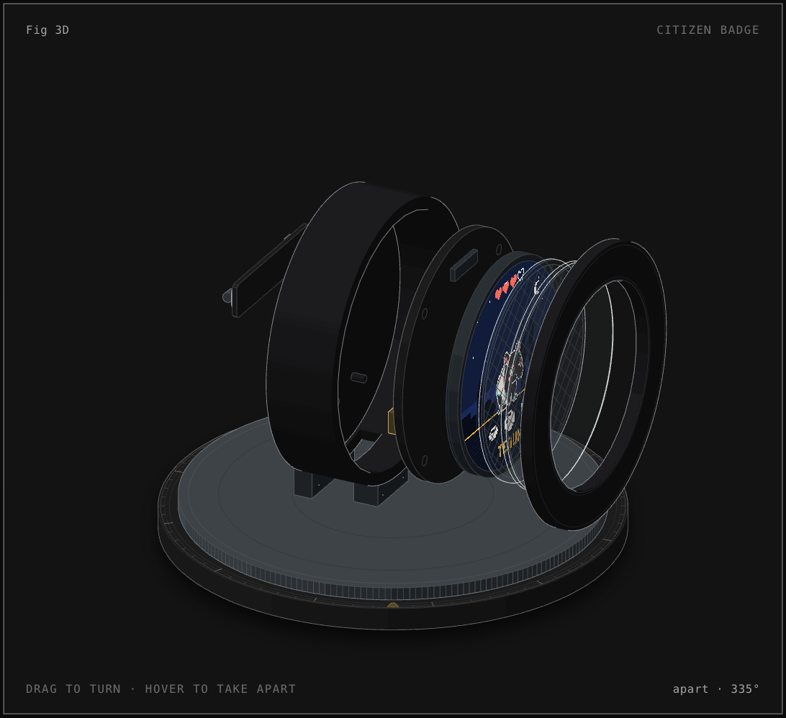

# Badge anatomy

An interactive 3D figure of the Citizen badge: the DIYMORE ESP32-2424S012C in its case, standing on a turntable. Drag to turn it, hover a part (or tap on a phone) to take it apart, and the readout shows that part's verified spec.

<p align="center"></p>

Open [`badge-3d/badge-3d.html`](badge-3d/badge-3d.html) (dark) or [`badge-3d/badge-3d-light.html`](badge-3d/badge-3d-light.html) in a browser. Each is one standalone file with no network requests.

## What is in it

| Piece | Parts | Readout |
|---|---|---|
| Front case | the lip ring with its chamfers | Case · black plastic · 1.28 in window |
| Cover glass | pane and chamfer, drawn clear | Cover glass · over the 1.28 in panel |
| Touch film | film with its sense grid, drawn clear | CST816S touch · I2C 0x15 |
| Display panel | GC9A01 panel showing `docs/screens/home.png`, its flex | GC9A01 panel · 240 x 240 · 1.28 in |
| Board | ESP32-C3-MINI-1U (module, shield, U.FL), USB-C, JST 1.25, BOOT and RESET switches, two chips, display socket, silkscreen | ESP32-C3-MINI-1U · 160 MHz · 4 MB flash, and per part: USB-C · 5 V, JST 1.25 · battery, not included, BOOT · GPIO 9 |
| Back shell | wall with the USB-C window, back plate, button plungers, battery cutout | Back shell · BOOT and RESET reachable |
| Bar pin | foam tape, bar, hinge, needle, catch | Bar pin on foam tape |

Every readout comes from [`docs/HARDWARE.md`](../HARDWARE.md). Sizes are drawn to look right, not measured off the part.

## Keys

Arrow left and right turn it by 15° (45° with Shift). Arrow up and down step through the pieces. Space or Enter takes it apart or puts it back. Escape resets. Under reduced motion the turntable stays still.

## Build

```sh
cd docs/anatomy/badge-3d
node build.mjs            # badge-3d.html
node build.mjs --light    # badge-3d-light.html
node build.mjs --verify   # badge-3d-verify.html, for the order check
node build.mjs --audit    # kit audit plus the orbit audit (about an hour); results in audit.txt
```

`model.mjs` holds the numbers and the explode plan, `build.mjs` the parts, `live.js` the turntable, hover and keys, `badge.css` the page styles.

## The kit

`kit/` and `scripts/inline-kit.mjs` are a copy of the anatomy skill's kit (MIT, see `kit/LICENSE`) with two local changes, both marked `Citizen badge:` in the source:

- `kit/turn.mjs`: the test for unstroked cut edges allows 0.3 units, not 1e-3. The badge's case is rings of sectors whose radial faces are cuts, and those planes are tilted and sit up to 200 units from the origin.
- `kit/turn-build.mjs`: part specs are packed at 4 decimals instead of 3, so tilted sectors draw on their own build-time planes.

## Checks (17 Oct 2026)

| Check | Result |
|---|---|
| `lines.mjs`, dark and light | 0 floating line ends |
| `turn-check --order`, full turn every 3° and 91 states across the explode | 0 pairs out of order |
| `turn-check --pops --step 1`, full turn | 0 pops |
| `turn-check --pops`, explode path in 1001 steps | 30 small antialiasing flips (1–9 px) on the back shell's joins as the paint order re-sorts |
| `turn-check --perf` | 6.9 ms per frame at 1440 px (60 fps); 29 ms at 390 px with 4× CPU throttle (30 fps) |
| kit audit (`--audit`) | passed |
| orbit audit (`--audit`) | see `badge-3d/audit.txt`. The quick run left painter cycles and births at the two edge-on angles (128° and 308°) and 1–3 px² swaps between neighbouring case sectors. None of these show in the pop check above. |
