# Screen gallery

Every screen the core renders, written by `make test` to `tests/out/*.ppm` and scaled 2x nearest-neighbour (`magick in.ppm -filter point -resize 200% out.png`). Native size is 240x240. Captions name the state the test put the pet in; the pet is Tenuk the tapir unless the caption says otherwise.

Regenerate after a screen change:

```
make test
for f in tests/out/*.ppm; do magick "$f" -filter point -resize 200% "docs/screens/$(basename "$f" .ppm).png"; done
```

## Hatch

| | | |
|---|---|---|
| 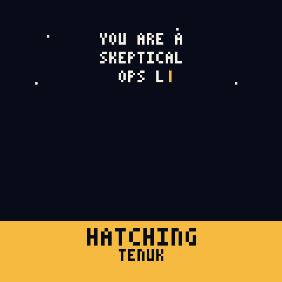 | 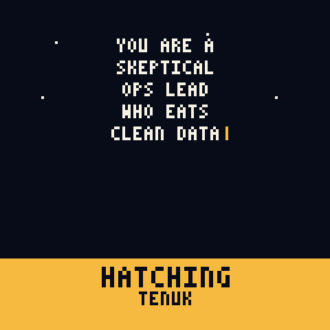 | 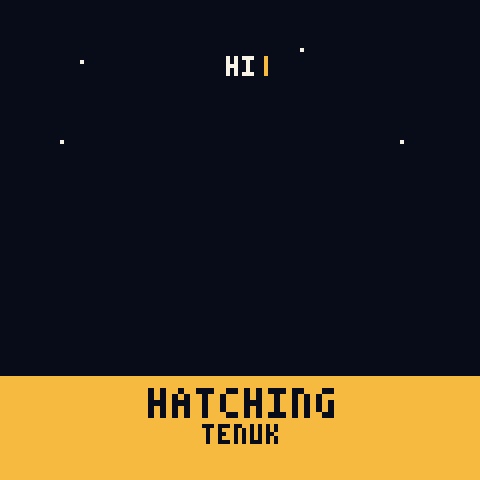 |
| Hatch, 1.5 s in: the default prompt typing out at 60 ms per character | Hatch, 3.5 s in: the prompt is complete and the pet is rising from under the band | Hatch rise, start: prompt "HI", sprite top at row 188, hidden by the band |
| 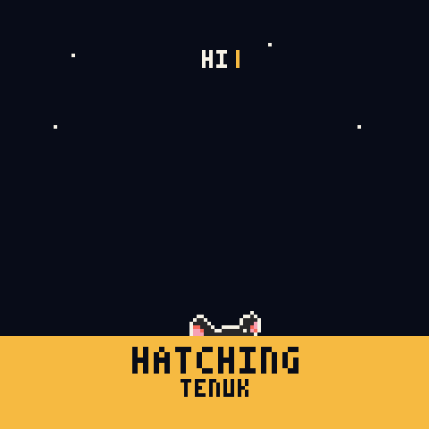 | 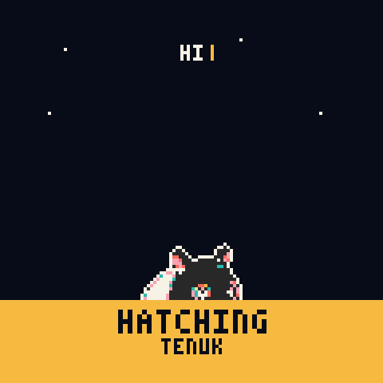 | |
| Hatch rise, 1 s into the 2 s hold: sprite top at row 174 | Hatch rise, end of the hold: sprite top at row 152, resting | |

## Home and the day cycle

| | | |
|---|---|---|
| 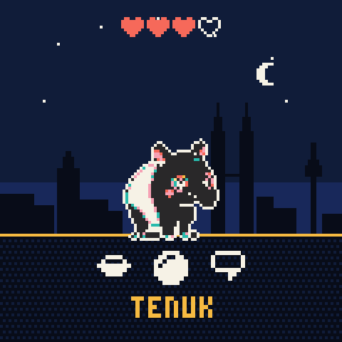 | 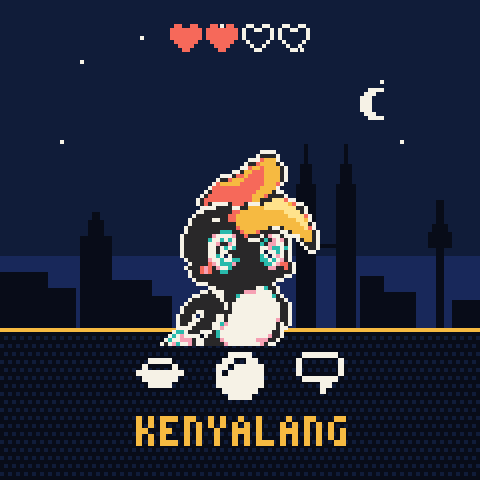 | 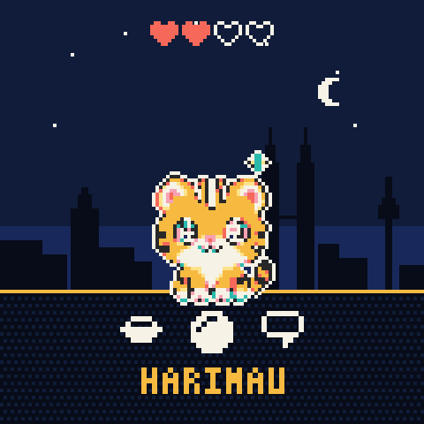 |
| Home, 3 hearts, clock unknown so the sky is night | Home, Kenyalang the hornbill | Home, Harimau the tiger |
| 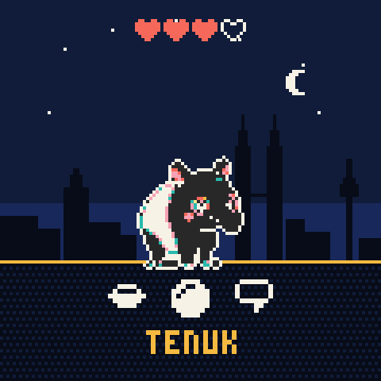 | 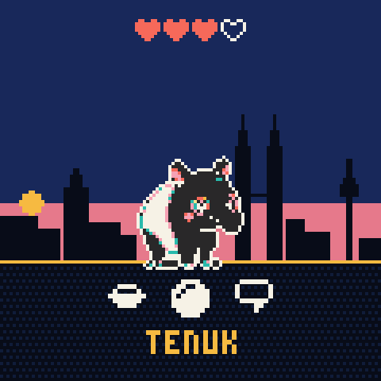 | 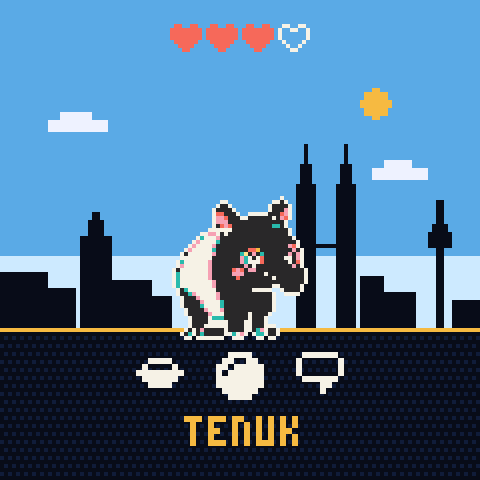 |
| Home at 03:00, night: navy sky, stars, moon, lit windows | Home at 07:00, dawn: dusk sky, rose band, sun low on the left | Home at 12:00, day: blue sky, clouds, sun top right |
| 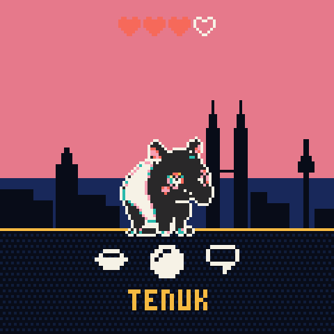 | | |
| Home at 18:30, dusk: rose sky, lit windows | | |

## Events

| | | |
|---|---|---|
| 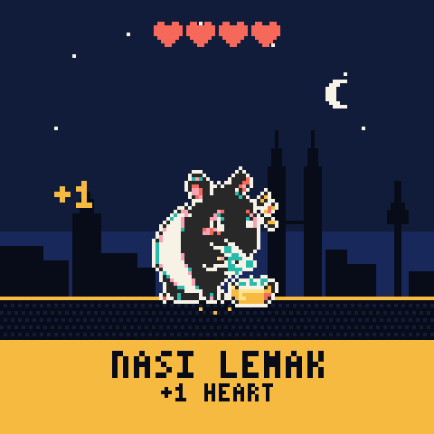 | 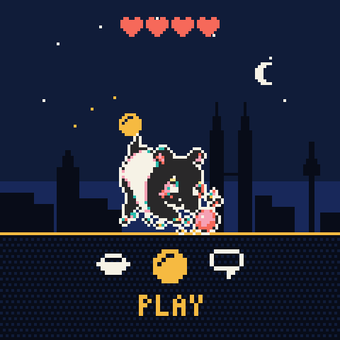 | 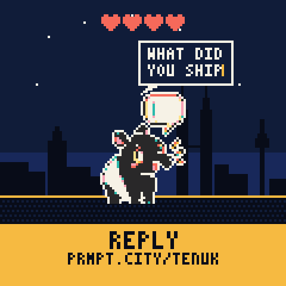 |
| Feed, after a tap: NASI LEMAK, +1 HEART, 4 hearts | Play, after a swipe: hop, ball arc, sparks | Talk: message "What did you ship" in the bubble, REPLY banner with the chat URL |
| 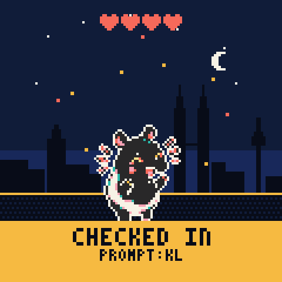 | 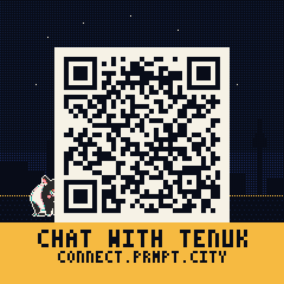 |  |
| Check-in: CHECKED IN, PROMPT:KL, confetti | QR after a 1 s hold, encoding the default URL, dimmed skyline behind | QR for `https://prmpt.city/c/tenuk-d2e8`: version 2, 6 px modules, 2-module quiet zone |

## Low states

| | |
|---|---|
| 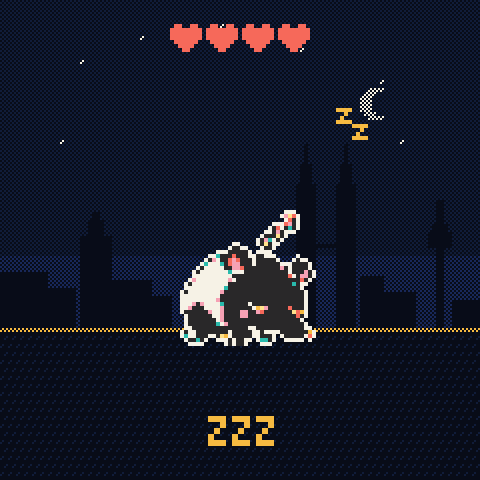 | 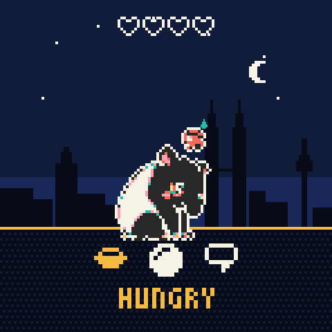 |
| Sleep, after 30 s idle: dimmed 60 percent, ZZ drifting | Sulk, 7 h without food: HUNGRY, bowl highlighted, sweat drop |

## Settings

| | | |
|---|---|---|
| 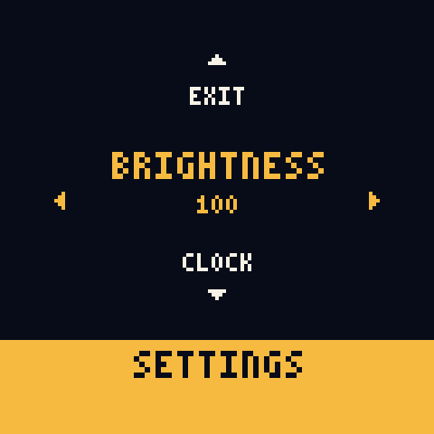 | 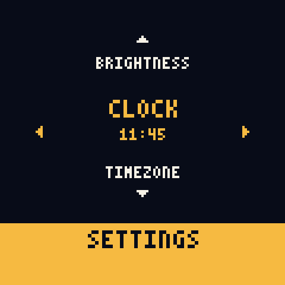 | 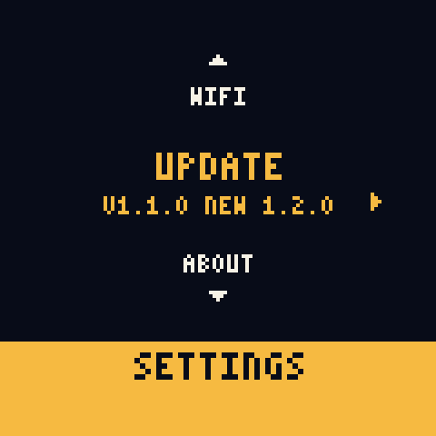 |
| Settings wheel opened by a double tap, on Brightness 100 | Clock row after tapping back twice from 12:15 to 11:45 | Update row showing V1.1.0 with NEW 1.2.0 available |
