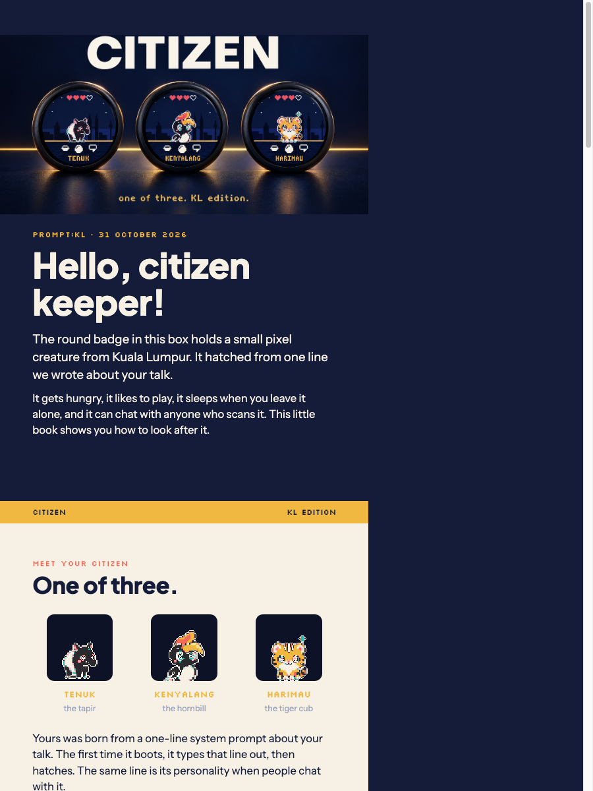

# Citizen speaker kit

A thank-you from PROMPT:KL, 31 October 2026.



## What is in the box

- The Citizen badge: a round touch screen with your pixel citizen inside
- A card with your citizen's name, its system prompt and a QR code to chat with it
- A lanyard
- Tape, to stick the badge on a laptop or a wall
- A loose pin, to wear it on a shirt or bag

## What it is

A small virtual pet on a round smart badge. Your citizen is one of three animals of Kuala Lumpur (Tenuk the tapir, Kenyalang the hornbill, Harimau the tiger cub). It hatched from a one-line system prompt we wrote about your talk. That line is printed on your card, typed out on the badge the first time it boots, and is the citizen's personality when people chat with it.

## What it can do

- Tap to feed it, swipe to play, and it keeps up to four hearts.
- It gets hungry over time and sulks if you forget it for six hours.
- It is always moving: breathing, blinking, hopping, eating.
- The sky follows the real clock, from dawn to blue day to dusk to a night with lit windows.
- Hold the screen for a second to show a QR code. Anyone who scans it can chat with your citizen.
- Replies from that chat appear on the badge within a minute when it is on WiFi.
- Double tap for Settings: brightness, clock, timezone, citizen, WiFi, update, about.
- It updates itself over WiFi from Settings → Update. USB flashing still works as a fallback.
- It sleeps after 30 seconds without a touch. A tap wakes it.
- It runs from any USB-C power source.

## What is in this folder

| Path | What |
|---|---|
| `booklet.pdf` | The 8-page A5 guide. Print it or send it |
| `booklet/index.html` | The booklet's source. One HTML page per printed page, images from `img/` |
| `thank-you/<slug>.pdf` | One A6 card per speaker, front and back |
| `thank-you/index.html`, `thank-you/make.mjs` | The card template and the script that fills it from `web/seed/badges.json` into `thank-you/build/` |
| `how-sync-works.md` | How the badge and the website talk to each other |
| `img/` | The images the booklet and cards use: `hero.jpg`, `board.jpg`, 4x screens, 8x idle sprites, `booklet-cover.png` |
| `preview/` | PNG previews of the booklet and card pages |
| `videos/`, `renders/` | The teaser, the launch film and the launch renders, copied in by `build.sh` and not committed. The originals are in `../assets/` |

## Getting help

Start with the last page of the booklet. If that does not fix it, message the PROMPT:KL team with what you see on the screen, and a photo if you can.

## Rebuilding this kit

```sh
kit/build.sh
```

Needs Google Chrome, Node, ImageMagick and `web/node_modules` installed, plus the art folders next to the repo (`screens/`, `sprites/`, `assets/`, `ref/` in `citizen-badge/`) and `tests/out/home_*.ppm` from `make test`. It:

1. Makes the print images in `img/`: idle sprites upscaled 8x (64 to 512 px) and screens upscaled 4x (240 to 960 px), both nearest-neighbour; the four time-of-day Home screens from the core's test output; `board.jpg` (2K) and `hero.jpg` from the v2 renders.
2. Copies the eight launch renders into `renders/` and the teaser and launch film into `videos/`.
3. Prints `booklet.pdf` from `booklet/index.html` with headless Chrome.
4. Runs `thank-you/make.mjs` to fill one card per badge in `web/seed/badges.json`, then prints each to `thank-you/<slug>.pdf`.

The cover image above is a plain screenshot of the booklet's first page:

```sh
"/Applications/Google Chrome.app/Contents/MacOS/Google Chrome" --headless=new --disable-gpu \
  --window-size=900,1200 --virtual-time-budget=6000 \
  --screenshot="$PWD/kit/img/booklet-cover.png" "file://$PWD/kit/booklet/index.html"
```
