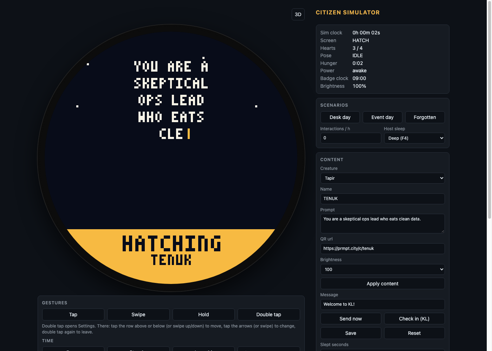
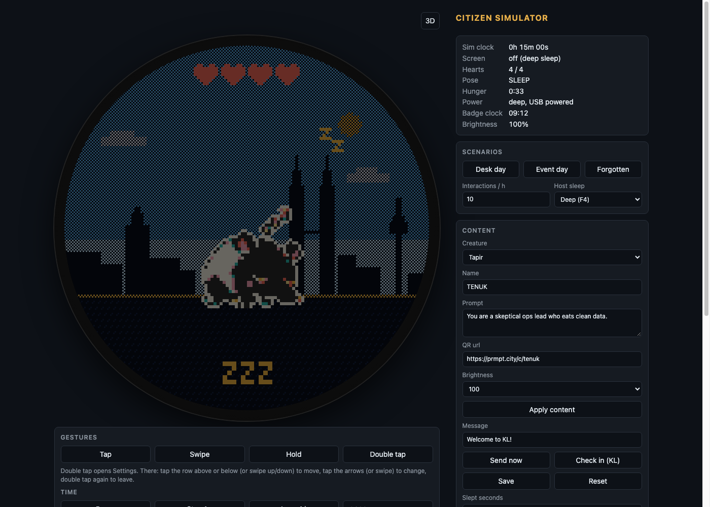

# Citizen simulator

Browser simulator for the Citizen badge (PRD section 5). It runs the real C core from `core/` compiled to
WebAssembly, draws the 240x240 framebuffer on a round canvas, takes the same raw touch events the firmware
feeds the core, and wraps it in a hardware model of the ESP32-C3 board so you can read frame time, current,
battery and temperature estimates while you fast-forward days of badge life. No bundler, no dependencies.



*First boot: the prompt types out on the Hatch screen. The right column shows the live readouts and the content panel.*

## Build and run

```
make wasm                        # at the repo root, builds sim/core.wasm with Homebrew LLVM
cd sim && python3 -m http.server 8791
```

Open http://localhost:8791. It must be served over HTTP, not opened as a file, so `core.wasm` and `hardware.json`
can be fetched. `make wasm` needs `/opt/homebrew/opt/llvm/bin/clang` and `wasm-ld` from the `lld` formula
(`brew install llvm lld`). The build is `--target=wasm32 -ffreestanding -nostdlib -O2` and exports exactly the
`cz_*` functions declared in `core/citizen.h`. The resulting `sim/core.wasm` is 139,684 bytes.

`scripts/check.sh` builds the wasm and runs the simulator selftest headlessly on port 8790 as part of the
repo-wide check.

## Files

- `index.html`: the page. Round bezel and screen canvas on the left, control panels on the right.
- `sim.js`: wasm host, simulated clock, gestures, scenarios, WiFi and sleep model, telemetry, CSV, selftest.
- `model.js`: the hardware model. Pure functions over a `hardware.json` profile: frame cost, current, sync charge,
  temperature, battery hours.
- `hardware.json`: the ESP32-C3 / ESP32-2424S012C profile. Every number is editable live under Nerd > Hardware constants.
- `badge3d.js`: the 3D badge view, loaded only when you switch to it.
- `core.wasm`: built by `make wasm`, not committed.

`window.cz` exposes the wasm exports and `window.sim` the simulator internals (`sim`, `hw`, `gesture`, `advanceTo`,
`runScenario`, `toCsv`, `importLog`) for poking from the console.

## The screen and gestures

The badge is drawn at 3x (a 720x720 canvas) with a round mask and bezel, nearest-neighbour scaled so every pixel
stays a crisp 3x3 block. Backlight brightness is approximated with a CSS brightness filter floored at 35% so the
10% setting stays readable on a monitor.

Mouse or finger on the screen sends raw touch events straight to the core (`cz_touch` down, move, up) and the core
detects the gesture, exactly as it does on the badge:

- Tap: click, or touch and release.
- Swipe: drag.
- Hold: press and keep still for 1 s.
- Double tap: two quick taps (within 400 ms).

While a finger is down the simulated clock runs at 1x whatever the speed setting, so gesture timing always uses
real time. If the badge is asleep, the first touch only wakes it and is swallowed, as on hardware.

The four gesture buttons under the screen inject fixed touch sequences for people without a mouse: Tap (down, up
after 80 ms), Swipe (a left-to-right drag over 160 ms), Hold (down, up after 1.1 s) and Double tap (two taps 150 ms
apart). Hold opens the QR screen. Double tap on Home or Sulk opens Settings.

### Settings wheel

Settings is a wheel of rows with the selected row in gold. To navigate:

- Move: tap the row above or below the selected one, or swipe up or down.
- Change a value: tap the left or right arrow on the selected row, or swipe left or right. The Swipe button is a
  horizontal swipe, so in Settings it changes the selected value.
- Leave: double tap again. Hold or 20 s without touching also exits.

Everything on the wheel is core behaviour (`core/citizen.c`), not simulator code.

## URL parameters

| Parameter | Effect |
|---|---|
| `?scenario=desk`, `event` or `forgotten` | Resets and starts that scenario on load (see Scenarios). |
| `?speed=N` | Sets the speed multiplier after the scenario has started. Any positive number works; values not in the dropdown are added to it. |
| `?view=3d` | Opens the 3D badge view instead of the flat screen. Without it the view last chosen with the 3D button is restored from localStorage. |
| `?selftest` | Runs the acceptance checks once on load and prints the result (see Selftest). |

They combine, for example http://localhost:8791/?view=3d&scenario=event&speed=60.

## Time

The simulator keeps its own clock in simulated milliseconds and advances it event by event: the core is ticked at
30 Hz of simulated time (every 33.3 ms, the most the firmware loop draws), and the loop also stops at the next
scheduled tap, sync, clock set, update arrival and one-second telemetry boundary. Between `requestAnimationFrame`
calls at most 250 ms of real time is consumed, so a backgrounded tab does not jump hours when it returns.

- Pause: freezes simulated time. Gestures still work while paused because a finger forces 1x.
- Step 1 s and Jump 1 h: advance exactly that much simulated time, even while paused.
- Speed: 1x, 10x, 60x, 600x or 3600x. One real second at 3600x is one simulated hour.

The status line under the buttons shows the current speed (or `paused`, or `1x` while a finger is down), the
scenario name and progress, `recording N s` while telemetry is being recorded, `message queued` when a web message
is waiting for a sync, and `request ...` after the core asked the host for something.

## Readouts

The box at the top of the right column refreshes every frame:

- Sim clock: simulated time since the page loaded (h, m, s).
- Screen: the core's current screen (HATCH, HOME, FEED, PLAY, TALK, QR, CHECKIN, SULK, SLEEP, SETTINGS), or
  `off (deep sleep)` when the host has powered the core down.
- Hearts: 0 to 4.
- Pose: the sprite pose (IDLE, BLINK, EAT, PLAY, SLEEP, SULK, TALK, CHEER).
- Hunger: minutes and seconds since the last feed.
- Power: `awake`, `light` or `deep`, plus `WiFi` when connected and `USB powered` in the desk scenario.
- Badge clock: the core's own wall clock (HH:MM), or `unknown` before it has been set.
- Brightness: the core's backlight percentage.

## Scenarios



*`?scenario=desk` a few simulated minutes in. The pet has gone to sleep and the host has deep-slept the core, so the readouts say `off (deep sleep)` and the Sleep frame is shown dimmed rather than black.*

A scenario resets the badge, forces host sleep to Deep and the sync interval to 60 s, sets the badge clock, runs
at 3600x with recording on, and pauses when its length is up. Three presets:

| Scenario | Clock | WiFi | Interactions | Length |
|---|---|---|---|---|
| Desk day | 09:00 | off | 10 taps/h | 8 h, marked USB powered |
| Event day | 10:00 | on | 60 taps/h | 10 h |
| Forgotten | 20:00 | off | none | 72 h |

Interactions arrive at random with Poisson spacing at the chosen rate in simulated time. You can edit
Interactions / h at any time. A tap that lands while the badge is asleep wakes it instead of being a tap, so in
Event day the number of wakes per hour is below 60 (the selftest prints `wakes_per_h`).

Host sleep decides what the simulated host does when the core reports `cz_wants_sleep`:

- Deep (F4): the host saves the 64-byte blob, powers the core off and stops ticking it. The next touch calls
  `cz_init` with the blob and the number of seconds slept, so the pet catches up on the time away. That waking
  touch is consumed. The radio is off; the first sync happens on wake.
- Light (F4 fallback): the core keeps running at the light-sleep current. A touch sends a tap to move from the
  Sleep screen back to Home. No syncs while asleep.
- None: nothing sleeps. The Sleep screen stays lit at the awake current and the periodic sync keeps going.

At 1x the screen goes black while asleep, like the real backlight. At higher speeds the sleep and wake cycle would
strobe, so the dimmed Sleep frame is kept visible at 10% instead.

## Content

What the web app and the organiser would provision onto a badge:

- Creature (Tapir, Hornbill, Tiger) and Brightness (100, 40, 10) apply as soon as you change them.
- Name (up to 10 characters), Prompt and QR url apply when you press Apply content. Strings go through the core's
  256-byte scratch buffer, so anything beyond 255 bytes is cut.
- Send now delivers the Message box straight to the core (`cz_message`), which shows the Talk screen.
- Check in (KL) calls `cz_checkin("KL")`, which shows the Check-in screen.
- Save writes the core's save blob to localStorage under `citizen-save`. Nothing in the simulator reads it back;
  it is there to inspect.
- Reset starts a fresh pet: new seed, no save blob, version back to 1.1.0, telemetry cleared, one boot sync.
- Wake from deep sleep saves, then re-inits from that blob with Slept seconds, the same path the firmware takes
  after a deep sleep. Useful to see what 3600 s or a whole night away does to hunger and hearts.

## Clock

The core advances its own wall clock from `cz_tick`; the host only sets it. Time of day calls `cz_set_clock` with
the minute of the day. Timezone (UTC-12 to UTC+14, default UTC+8) calls `cz_set_timezone`. "Use my computer's
clock" re-sets the badge clock from `Date` every simulated minute; editing Time of day switches it off again.
Scenarios set the clock themselves (09:00, 10:00, 20:00). The day and night skyline follows this clock, which the
selftest checks by comparing a pixel at noon and at 03:00.

## Host requests

The core asks the host for things through `cz_host_request()`, which the simulator polls every tick. The request
name appears in the status line:

- PORTAL: `portal would start (simulated)`. The firmware would open the WiFi captive portal.
- CHECK_UPDATE: after 2 simulated seconds the simulator answers `cz_set_update("1.1.1")`, so Settings shows an
  update available.
- INSTALL_UPDATE: `would reboot into 1.1.1`. The running version becomes 1.1.1 and the pending update clears.
- FACTORY_RESET: only named in the status line.

The running version (1.1.0) and the WiFi state (`PromptKL`, connected or off) are fed to the core on boot, after
every re-init and whenever the WiFi toggle changes, the way the firmware does after `cz_init`.

## WiFi and sync

The sync policy is the firmware's F6: one sync at boot and at every wake, then one every Sync interval seconds
(60 by default) while awake, and none while asleep. Sleeping cancels the timer; the next wake restarts it.

- Connected: tells the core the WiFi state and, when switched on, syncs immediately.
- Sync every (s): the interval, minimum 1. Scenarios force it back to 60.
- Queue message: holds the "Message from the web" text (up to 64 characters) until the next sync, then delivers
  it with `cz_message`. Queue check-in does the same with `cz_checkin("KL")`.
- A sync while the badge is still on the Hatch screen keeps the content queued, because the core ignores it
  during Hatch.

Each sync charges the power model with one TX burst (see the hardware model) and bumps the `syncs` counter in the
Nerd panel.

## Live mode

Live mode makes the simulated badge follow a real one. With the box ticked, the simulator fetches `<badge url>/state`
every 10 s of real time (`cache: no-store`) and expects JSON with optional string fields `msg` and `checkin`. When
either value changes it is delivered to the core (cut to 64 characters); if the badge is asleep or still hatching
it is queued for the next sync instead. The line under the box reads `live: ok HH:MM:SS` after each successful
poll, or the error. The default url is `https://prmpt.city/api/c/tenuk`.
